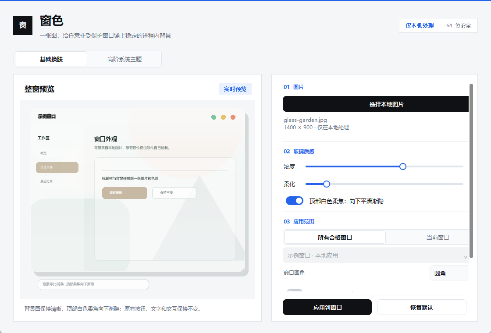

# WindowTint / 窗色 0.4.15

用一张本地图片，给 Windows 11 普通桌面窗口加入一层柔和、稳定的进程内玻璃背景。

WindowTint 会把带版本号的自带 DLL 载入通过安全筛选的 64 位目标进程，
并在目标进程内创建一个覆盖整窗、鼠标穿透的透明图片层。该层由目标窗口的原生移动、缩放消息
驱动，不修改标题栏、边框或文字颜色。



## 下载

从 [GitHub Releases](https://github.com/gogogo-xixi/WindowTint/releases/latest) 下载
`WindowTint-0.4.15-win64.zip`，解压后直接运行 `WindowTint.exe`。

发布包必须同时保留 `WindowTint.exe` 和 `WindowTintInjector-0.4.15.dll`。首次启动时
Windows SmartScreen 或安全软件可能提示未知发布者，这是未签名注入工具的正常风险提示。

## 当前能力

- 向通过筛选的 64 位普通桌面进程载入本地注入 DLL。
- 在目标窗口内创建覆盖标题栏、边框和正文的柔和透明图片层。
- 默认使用 4 px 轻度柔化，并按每个目标窗口的真实尺寸生成主题图。
- 背景图按窗口比例等比居中铺满，不拉伸、不使用上下模糊补边，也不会留下明显分隔。
- 顶部白色柔焦连续向下渐隐，不会因图片或窗口比例产生弧形色带；可随时关闭并立即刷新。
- 原有文字、按钮、图片和滚动操作仍然由目标软件处理。
- 玻璃层跟随目标窗口移动、缩放、最小化与关闭。
- 超大窗口只按最长边 1920 的中间尺寸渲染，再交给系统高质量缩放，避免缩放时反复生成整张高分图造成卡顿。
- 窗口最大化或拖动调整尺寸后，会在尺寸稳定时按新窗口大小后台重建背景，避免旧图放大发糊和蒙版比例错位。
- 普通窗口拖动时按原生目标位置预移动透明层；Explorer 外部层在前台时以 8 毫秒间隔主动校准，拖动过程中背景保持可见。
- 重复应用同一窗口时复用唯一透明层，并清理旧版本遗留的孤儿层。
- 注入前检查目标进程已加载的注入器；发现不同版本时拒绝叠加并提示重启目标程序。
- 文件资源管理器使用不注入 `explorer.exe` 的外部兼容层，文件窗口可独立应用和恢复。
- 标准 Win32 窗口和系统对话框使用绘制钩子把图片垫到窗口背景层，文字和控件仍由应用绘制在上层；自绘框架继续使用透明覆盖层。
- Explorer 外部层使用 Windows 位置事件即时跟随；前台拖动时启用 8 毫秒主动校准，100 毫秒轮询只作为后台兜底。
- 可应用到一个窗口或所有通过安全筛选的可见窗口。
- 默认应用到所有合格窗口，并自动监视之后打开的新窗口。
- 可关闭设置窗口并常驻托盘，继续监视新打开的合格窗口。
- 自动检测已经运行的窗色实例；重复启动只会打开现有设置窗口，不会叠加托盘进程。
- 设置页使用浅色界面、自定义抗锯齿圆角控件、中文选项和细圆角滚动条。
- 图片只在本地处理；窗口标题、进程列表和图片不会上传。
- 标题栏、边框和文字保持系统原生配色，只可调整窗口圆角。

## 重要边界

- 当前只处理 64 位、同一权限级别、非 AppContainer 的普通桌面进程。
- 资源管理器文件窗口不注入 Shell 进程，而是由本工具创建外部点击穿透层。
- 明确跳过系统进程、安全软件、反作弊模块、提权目标和 32 位进程。
- 注入属于侵入式行为。未签名 DLL 和远程线程可能触发杀毒软件或 EDR 告警。
- 注入代码如果发生兼容性问题，可能影响目标程序稳定性；当前仍需要更广泛的软件矩阵测试。
- 图片层位于目标窗口内容上方，并不是把像素真正插入每个软件的原生绘制栈底层。
- 对独占全屏、DRM 内容、受保护视频、安全桌面、锁屏和硬件覆盖层不生效。
- 第三方软件若使用独占全屏、受保护视频或特殊硬件覆盖层，图片层可能显示异常。
- 当前版本需要 Windows 11 build 22000 或更高版本。

## 开发运行

```powershell
.\launch.ps1
```

应用入口会从 `bin\WindowTintInjector.dll` 载入注入模块。首次运行前可以单独构建：

```powershell
.\build_injector.ps1
```

运行自动测试：

```powershell
.\test.ps1
```

运行真实窗口注入测试：

```powershell
python .\tests\injection_smoke.py
```

测试会打开一个真实 Tk 窗口，把 DLL 注入该进程并连续应用三次，检查始终只有一个透明层、
截图是否变化，并验证恢复后不会留下可见背景层。

运行最大化尺寸刷新测试：

```powershell
python .\tests\maximize_refresh_smoke.py
```

测试会把真实注入目标最大化，确认透明层获得与最大化窗口完全一致的新尺寸位图，
而不是继续显示按初始窗口尺寸生成的旧背景。

运行单实例托盘测试：

```powershell
python .\tests\single_instance_smoke.py
```

测试会先启动第一个实例并关闭到托盘，再启动第二个实例，确认第二次启动只恢复原窗口并退出。

## 构建发布包

```powershell
.\build.ps1
```

输出：

- `dist\WindowTint-0.4.15-win64.zip`

发布目录内会同时包含 `WindowTintInjector-0.4.15.dll`，它必须与 `WindowTint.exe` 放在同一目录。
发布包不能只包含单个 EXE。已打开的目标程序会一直锁定载入的 DLL，直到该程序退出。

## 数据流

```text
图片
  -> Pillow 柔化与 Alpha 合成
  -> 本地版本化 PNG
  -> 安全窗口枚举
  -> 设置窗口圆角，不改原生标题栏/边框颜色
  -> 普通窗口：载入带版本号的 WindowTintInjector DLL
  -> 普通窗口：目标进程内创建鼠标穿透整窗透明层
  -> 资源管理器：本工具进程内创建外部鼠标穿透透明层
  -> 资源管理器：WinEvent 位置事件驱动外部层跟随，100 毫秒轮询兜底
  -> UpdateLayeredWindow 显示完整背景
```

Explorer 外部层仍然是独立于 Shell 进程的顶层窗口。它可以快速跟随文件窗口，但无法由
Windows 与 Explorer 做同一窗口的同帧合成。要达到完全无缝的原生背景，只能修改或注入
`explorer.exe`；当前版本出于系统稳定性与安全边界明确不这样做。

运行目录只保存当前背景图。正常恢复会销毁目标窗口中的透明图片层，但已载入目标进程的
DLL 会保留到目标程序退出，这是当前设计的已知限制。

## 许可证

WindowTint 自身使用 MIT 许可证。界面、代码和发布包不包含 Stardock、Microsoft 或其他
第三方的皮肤资源。
